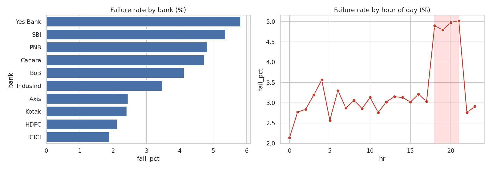

# UPI Payments Failure & Fraud Analytics

> **Data note:** the dataset is *simulated* by `generate_data.py` (no real customer/student data). Figures below come from that simulation. Replace data/upi_transactions.csv with real/anonymised data, or NPCI monthly bank-wise statistics (npci.org.in) for the bank-level views. Keep column names.

## Business question
Which banks, hours and transaction types drive failed and fraudulent UPI payments, and what should a payments team do about it?

## Stack
SQL (CTEs, window functions, LAG, rolling frames), Python (pandas, seaborn), Power BI-ready CSVs

## Repo structure
```
data/        generated CSV
sql/         analytical queries (SQLite-compatible)
analysis.py  runs queries, stats, charts; writes outputs/
outputs/     charts, Power BI-ready CSVs, results
```
Run: `python generate_data.py && python analysis.py`

## Key findings
- Overall failure rate: 3.57%. Worst bank: Yes Bank (5.82%); best: ICICI (1.89%).
- Peak hours 18:00-21:59 fail at 4.90% vs 3.00% off-peak (1.63x). ~1,147 excess failed txns attributable to peak congestion.
- Highest fraud segment: Collect Request / 1k-20k at 0.599% fraud.
- Simple rule (amount>20k OR collect request OR 00-05h) flags 10.0% of txns: precision 0.4%, recall 37.0%.



## Limitations
Fraud rule has high recall-vs-precision tradeoff (fraud is ~0.1% of txns). Next step: add a classifier with class weighting.

## Resume bullets (edit numbers if you swap in real data)
- Analyzed 200K UPI transactions with SQL (CTEs, window functions) and Python; found peak-hour (18:00-22:00) failure rate 1.6x off-peak and ranked 10 banks by decline rate to target reliability fixes.
- Built rule-based fraud risk segments (amount, hour, collect-request) and evaluated precision/recall; surfaced Collect Request 1k-20k as the highest-risk segment and a Power BI-ready KPI layer.
