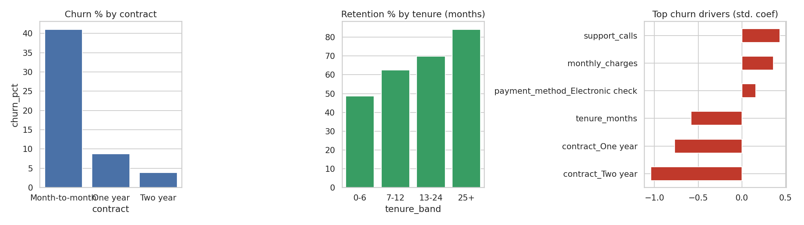

# Customer Churn, Retention & Revenue Impact

> **Data note:** the dataset is *simulated* by `generate_data.py` (no real customer/student data). Figures below come from that simulation. Swap in the Kaggle 'Telco Customer Churn' CSV (map columns to: contract, internet, tenure_months, monthly_charges, payment_method, support_calls, churn).

## Business question
Who churns, why, and is a retention campaign worth running (in rupees)?

## Stack
SQL, pandas, cohort/segment analysis, logistic regression baseline (scikit-learn), scenario/break-even analysis

## Repo structure
```
data/        generated CSV
sql/         analytical queries (SQLite-compatible)
analysis.py  runs queries, stats, charts; writes outputs/
outputs/     charts, Power BI-ready CSVs, results
```
Run: `python generate_data.py && python analysis.py`

## Key findings
- Overall churn 25.4%. Month-to-month churn 41.0% vs Two-year 3.9%.
- Retention is 48.7% in months 0-6 vs 84.1% at 25+ months.
- Logistic regression baseline AUC = 0.834. Strongest drivers: contract_Two year, contract_One year, tenure_months, support_calls.
- Campaign on top-10% risk customers (n=700): annualised revenue at risk Rs 523,600; at an ASSUMED 20% save rate and Rs100/customer offer, projected saving Rs 104,720 vs cost Rs 70,000 (net Rs 34,720). Break-even save rate: 13.4%.



## Limitations
Campaign save rate (20%) and offer cost (Rs100) are ASSUMPTIONS, clearly labelled; replace with real campaign data.

## Resume bullets (edit numbers if you swap in real data)
- Segmented 7K subscribers by contract, tenure and service; identified month-to-month customers churning ~10x more than two-year contracts and built a logistic baseline (AUC 0.83) to rank risk.
- Sized a retention campaign on the top-risk decile with break-even save-rate analysis (13.4%), turning model output into a go/no-go business recommendation.
