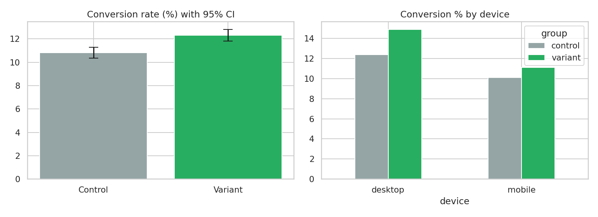

# A/B Test: One-Page vs Multi-Step Checkout

> **Data note:** the dataset is *simulated* by `generate_data.py` (no real customer/student data). Figures below come from that simulation. Replace data/ab_test.csv with a real experiment export (user_id, group, device, converted, order_value) or the Kaggle 'A/B Testing' dataset.

## Business question
Should the product team ship a one-page checkout?

## Stack
Experiment design, power/sample-size calculation, two-proportion z-test, confidence intervals, Welch t-test, segment analysis

## Repo structure
```
data/        generated CSV
sql/         analytical queries (SQLite-compatible)
analysis.py  runs queries, stats, charts; writes outputs/
outputs/     charts, Power BI-ready CSVs, results
```
Run: `python generate_data.py && python analysis.py`

## Key findings
- Required sample/arm for 1pp MDE at 80% power: 15,973. Actual: 16,500 and 16,500 (adequately powered: True).
- Control 10.82% vs Variant 12.32% -> lift +1.50pp (+13.8% relative).
- z = 4.25, p<0.001, 95% CI for difference: [0.81pp, 2.19pp].
- Revenue/user: control Rs87.1 vs variant Rs101.6 (Welch t-test p<0.001).
- Device split: mobile 10.1% -> 11.1%; desktop 12.4% -> 14.9%.
- **Recommendation: SHIP the variant.**



## Limitations
Always check sample ratio and run the test for full weekly cycles in real experiments; this simulation skips novelty effects.

## Resume bullets (edit numbers if you swap in real data)
- Designed and analysed a checkout A/B test (33K users): pre-computed required sample size (80% power), ran a two-proportion z-test (p<0.001, +1.5pp lift, 95% CI 0.8-2.2pp) and wrote a ship/no-ship decision memo.
- Validated results with revenue-per-user Welch t-test and device segmentation, showing desktop lift larger than mobile.
