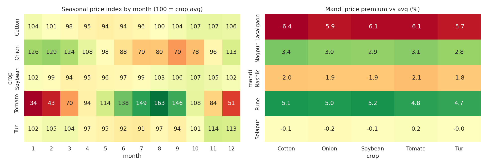

# Maharashtra Mandi Price Seasonality & Volatility Analytics

> **Data note:** the dataset is *simulated* by `generate_data.py` (no real customer/student data). Figures below come from that simulation. Replace data/mandi_prices.csv with Agmarknet / data.gov.in commodity price exports (agmarknet.gov.in); keep columns week, crop, mandi, modal_price, arrivals_qtl.

## Business question
When should farmers sell each crop, which markets pay a premium, and which crops are riskiest?

## Stack
SQL (window functions, RANK), time-series decomposition (statsmodels), seasonal indices, volatility (CV), heatmaps

## Repo structure
```
data/        generated CSV
sql/         analytical queries (SQLite-compatible)
analysis.py  runs queries, stats, charts; writes outputs/
outputs/     charts, Power BI-ready CSVs, results
```
Run: `python generate_data.py && python analysis.py`

## Key findings
- Most volatile crop (CV): Tomato (61.4%); least: Cotton (7.7%).
- Cotton: sell in Oct (index 107), avoid May (index 94); seasonal swing 13 pts; price-arrivals corr -0.0.
- Onion: sell in Feb (index 129), avoid Sep (index 70); seasonal swing 59 pts; price-arrivals corr -0.14.
- Soybean: sell in Oct (index 107), avoid Mar (index 94); seasonal swing 13 pts; price-arrivals corr -0.04.
- Tomato: sell in Aug (index 163), avoid Jan (index 34); seasonal swing 128 pts; price-arrivals corr -0.17.
- Tur: sell in Nov (index 114), avoid Jul (index 91); seasonal swing 23 pts; price-arrivals corr 0.03.
- Highest-premium market overall: Pune (5.0% above average).



## Limitations
Simulated prices encode seasonality by construction; with real Agmarknet data, expect noisier patterns and report them honestly.

## Resume bullets (edit numbers if you swap in real data)
- Analysed 4,800 weekly mandi price records across 5 crops and 5 Maharashtra markets; built seasonal price indices and volatility metrics (tomato CV 61% vs cotton 8%) to identify optimal selling windows.
- Decomposed onion prices into trend, seasonality and residual (statsmodels) and quantified inter-market price premiums for sell-location decisions.
