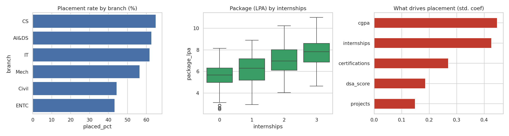

# Campus Placement Analytics (Statistical Case Study)

> **Data note:** the dataset is *simulated* by `generate_data.py` (no real customer/student data). Figures below come from that simulation. Use your own anonymised college data with the same columns (branch, gender, cgpa, internships, projects, certifications, dsa_score, placed, package_lpa).

## Business question
What actually drives placement outcomes and packages, and which differences are statistically real?

## Stack
SQL, pandas, ANOVA, Welch t-test, chi-square, point-biserial correlation, logistic regression driver model, seaborn

## Repo structure
```
data/        generated CSV
sql/         analytical queries (SQLite-compatible)
analysis.py  runs queries, stats, charts; writes outputs/
outputs/     charts, Power BI-ready CSVs, results
```
Run: `python generate_data.py && python analysis.py`

## Key findings
- Overall placement rate 57.4%; average package Rs 6.43 LPA.
- Best branch by placement: CS (65.0%); lowest: ENTC (43.3%). ANOVA on package across branches: F=44.8, p<0.001.
- Students with 2+ internships earn Rs 7.29 LPA vs Rs 5.64 LPA with none (Welch t-test p<0.001).
- CGPA vs placement point-biserial r = 0.20 (p<0.001).
- Gender vs placement chi-square p = 0.530; package gap M-F among placed = Rs 0.04 LPA.
- Strongest standardized driver: cgpa.



## Limitations
Anonymise any real student data and get permission before publishing.

## Resume bullets (edit numbers if you swap in real data)
- Analysed 1,200 student records with SQL and Python; showed students with 2+ internships earn ~Rs 1.6 LPA more (Welch t-test, p<0.001) and ranked CGPA and internships as the top standardized placement drivers.
- Applied ANOVA, chi-square and correlation tests to separate statistically significant effects (branch, CGPA) from noise, and presented findings in a recruiter-ready summary.
